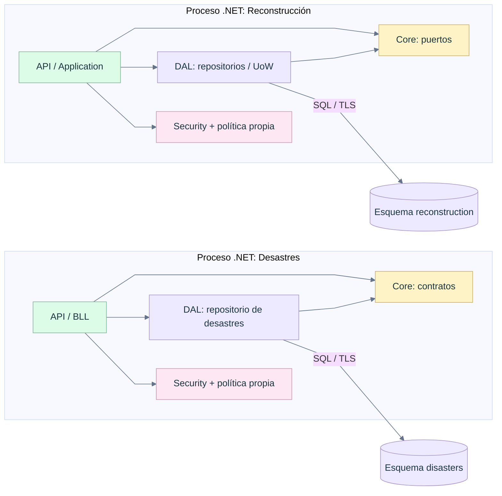
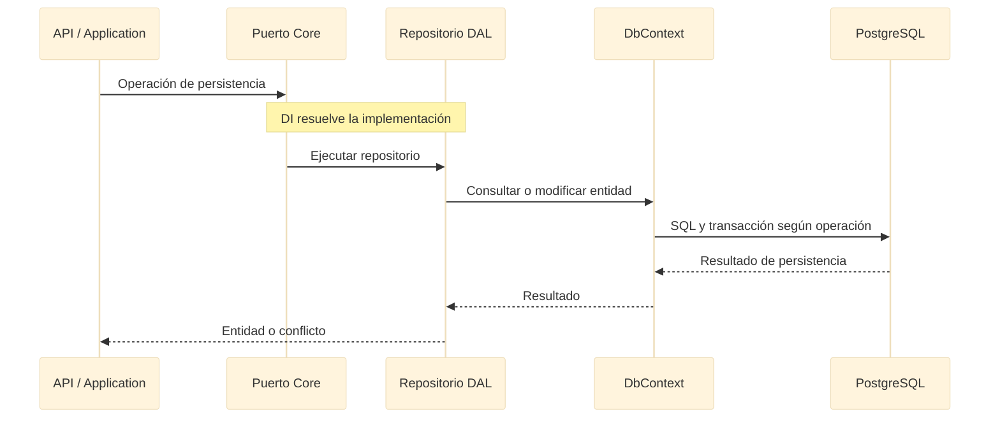
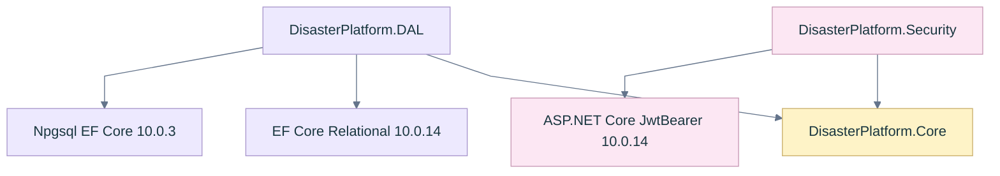

<div align="center">

# RECONECTA

### Platform DAL

**De la emergencia a la reconstrucción**

Bibliotecas compartidas de dominio, persistencia y seguridad .NET.


**Pontificia Universidad Javeriana**

Arquitectura de Software · 2026

[Plataforma completa](https://github.com/disaster-management-platform/disaster-platform-infrastructure) · [Arquitectura](#arquitectura) · [Demostración](#demostración) · [Instalación](#instalación-y-ejecución)

</div>

---

## Demostración

<div align="center">

[](https://youtu.be/HVCKoTRAxu8)

[Ver demostración funcional de RECONECTA](https://youtu.be/HVCKoTRAxu8)

</div>

## Descripción

`disaster-platform-dal` centraliza contratos, entidades y mecanismos de acceso a datos utilizados por los servicios .NET de RECONECTA. Distribuye tres bibliotecas NuGet: DisasterPlatform.Core, DisasterPlatform.DAL y DisasterPlatform.Security. No es una API remota, no es un proceso independiente y no necesita contenedor propio. Cada servicio incorpora la versión que declara en su proyecto y mantiene la propiedad de su esquema y transacciones.

## Contenido

- [Funcionalidades](#funcionalidades)
- [Arquitectura](#arquitectura)
- [Decisiones arquitectónicas](#decisiones-arquitectónicas)
- [Tecnologías y justificación](#tecnologías-y-justificación)
- [Estructura del repositorio](#estructura-del-repositorio)
- [Integración con otros componentes](#integración-con-otros-componentes)
- [Persistencia](#persistencia)
- [Contratos de comunicación](#contratos-de-comunicación)
- [Seguridad](#seguridad)
- [Instalación y ejecución](#instalación-y-ejecución)
- [Pruebas](#pruebas)
- [Alcance y validación](#alcance-y-validación)
- [Repositorios relacionados](#repositorios-relacionados)
- [Autores](#autores)

## Funcionalidades

| Funcionalidad | Descripción |
| --- | --- |
| Core | Entidades, invariantes, interfaces de repositorio, eventos y contratos. |
| DAL | EF Core, DbContexts, repositorios, configuración PostgreSQL y migraciones. |
| Desastres | Recibos de comando, índices, auditoría, Outbox y consultas por ámbito. |
| Reconstrucción | Repositorios, reservas, unidad de trabajo, historial, Inbox y Outbox. |
| Security | Configuración JWT y adaptación de claims al ámbito de desastre. |
| Distribución | Paquetes versionados para consumo desde repositorios independientes. |

## Arquitectura

### Vista lógica — dependencias de bibliotecas


Aunque los procesos cargan bibliotecas comunes, no comparten un DbContext ni una instancia de repositorio a través de la red. No deben acceder a las tablas de otro propietario para integrar dominios.

### Paquetes y versiones declaradas

| Paquete | Versión en su csproj | Responsabilidad |
| --- | --- | --- |
| `DisasterPlatform.Core` | 5.0.0 | Modelos, invariantes y contratos. |
| `DisasterPlatform.DAL` | 7.0.0 | EF Core, repositorios y migraciones. |
| `DisasterPlatform.Security` | 1.0.0 | JWT y políticas comunes. |
Estas son versiones del código consultado, no una comprobación de publicación efectiva en el registro. Desastres referencia Core 5 / DAL 7 / Security 1; Reconstrucción referencia Core 4 / DAL 6 / Security 1. Las actualizaciones se deben coordinar sin obligar a desplegar todos los servicios simultáneamente.

### Responsabilidades de los componentes

| Componente | Responsabilidad |
| --- | --- |
| DisasterPlatform.Core | Entidades de Desastres y Reconstrucción, IDisasterRepository, contratos de persistencia y eventos. |
| DisasterDbContext | Mapeo y migraciones de disasters. |
| ReconstructionDbContext | Mapeo y migraciones de reconstruction. |
| DisasterRepository / DisasterCommandStore | CRUD autorizado, recibos y comandos. |
| ReconstructionUnitOfWork | Coordinación transaccional de cambios de reconstrucción. |
| ConsumerInbox / WorkflowReplaySource | Deduplicación y recuperación de proyecciones. |
| PlatformDatabase | Normalización de conexión, TLS, UTC e inicialización explícita. |
| PlatformSecurity | Configuración de autenticación y políticas comunes. |

### Secuencia de acceso a datos


### Vista de desarrollo



## Decisiones arquitectónicas

| Atributo de calidad | Decisión | Mecanismo y compromiso |
| --- | --- | --- |
| Modificabilidad | Repository / contratos | Separa negocio de EF; compartir contratos exige disciplina de versionamiento. |
| Integridad | Restricciones y transacciones | Índices, versiones y recibos evitan efectos duplicados; conflictos explícitos. |
| Interoperabilidad | Bibliotecas .NET y PostgreSQL | Reutilización interna; integración con Java se mantiene por API y JDBC, no NuGet. |
| Desplegabilidad | Paquetes versionados | Cada servicio elige versiones y se despliega por separado. |
| Recuperabilidad | Outbox / Inbox y migraciones | Conserva identidad y estado; necesita respaldo y coordinación de cambios de esquema. |
| Seguridad | Roles y conexiones separadas | Reduce alcance de credenciales; las políticas de negocio siguen en servicios propietarios. |

## Tecnologías y justificación

| Tecnología | Justificación para la integración |
| --- | --- |
| .NET 10 / C# | Mantiene compatibilidad binaria y de contratos con los dos servicios consumidores .NET. |
| NuGet / GitHub Packages | Distribuye código reutilizable y permite versionar dependencias sin desplegar un servidor DAL. |
| EF Core 10.0.14 | Mapea entidades, relaciones, transacciones y migraciones sin introducir SQL en la lógica de negocio. |
| Npgsql EF Core 10.0.3 | Conecta a PostgreSQL/Supabase y permite utilizar restricciones, esquemas y transacciones del motor. |
| PostgreSQL | Soporta esquemas propietarios, restricciones únicas y mecanismos de sincronización. |
| ASP.NET Core JwtBearer 10.0.14 | Reutiliza integración estándar con el emisor de identidad común. |

## Estructura del repositorio

```text
disaster-platform-dal/
├── DisasterPlatform.Core/
│   ├── Contracts/
│   ├── Disasters/
│   ├── Messaging/
│   └── Reconstruction/
├── DisasterPlatform.DAL/
│   ├── Contexts/
│   ├── Disasters/
│   ├── Messaging/
│   ├── Migrations/
│   │   ├── Disasters/
│   │   └── Reconstruction/
│   ├── Models/
│   ├── Repositories/
│   ├── Transactions/
│   ├── DependencyInjection.cs
│   └── PlatformDatabase.cs
├── Platform.Security/
│   └── PlatformSecurity.cs
└── DisasterPlatform.sln
```

## Integración con otros componentes

Gestión de Desastres consume `IDisasterRepository` y las implementaciones DAL de su contexto. Reconstrucción consume puertos como `IProposalRepository`, `IProjectRepository`, `IFundingReservationRepository`, `IReconstructionUnitOfWork`, `IConsumerInbox` e `ITimelineWriter`. La inyección de dependencias registra repositorios y contextos con scope. Los servicios Java utilizan JPA/JDBC propios. Gateway y clientes no dependen directamente de esta biblioteca.

## Persistencia

| Contexto | Esquema | Historial de migraciones |
|---|---|---|
| `DisasterDbContext` | `disasters` | `__EFMigrationsHistory_Disaster` |
| `ReconstructionDbContext` | `reconstruction` | `__EFMigrationsHistory_Reconstruction` |

`PlatformDatabase.ResolveConnectionString` requiere host y base, fuerza `SSL Mode=VerifyFull` en conexiones TCP, normaliza timezone UTC y evita exponer detalles sensibles. Cada API recibe un login propio; las credenciales de migración se mantienen separadas. La inicialización explícita usa un advisory lock para serializar migraciones, pero ambas llamadas de migración no deben interpretarse como una única transacción atómica entre contextos. Las migraciones no se ejecutan en el arranque normal de los consumidores. El ámbito de los registros de Desastres se conserva en el snapshot original; no se inventa información para registros históricos.

## Contratos de comunicación

No publica endpoints HTTP. Sus contratos son interfaces .NET, registros de dominio y eventos versionados.

| Contrato | Propósito |
|---|---|
| `IDisasterRepository` | Persistencia y consulta de desastres. |
| `IDisasterAccess` | Ámbito de desastre utilizado por repositorios. |
| `IProposalRepository`, `IProjectRepository` | Persistencia de propuestas y proyectos. |
| `IFundingReservationRepository` | Reservas presupuestales. |
| `IReconstructionUnitOfWork` | Unidad de trabajo de Reconstrucción. |
| `IConsumerInbox` | Identidad persistente de operaciones consumidas. |
| `IWorkflowReplaySource` | Lectura para recuperación de proyecciones. |

Las interfaces se consultan en `DisasterPlatform.Core/Contracts` y `DisasterPlatform.Core/Disasters`. Los eventos se definen en `DisasterPlatform.Core/Messaging`. No confundir contratos de biblioteca con APIs públicas de la plataforma.

## Seguridad

`DisasterPlatform.Security` implementa JWT Bearer con validación de issuer, audience, expiración y metadatos HTTPS. `ClaimsDisasterAccess` traduce concesiones `disaster_id`; las políticas propias de Desastres y Reconstrucción amplían el ámbito según el propietario. El código común contiene políticas `reconstruction.read/write`; no sustituye las políticas específicas de Desastres. `LocalDemo` solo se admite en Development. La implementación alternativa `UnrestrictedDisasterAccess` del DAL no constituye una autorización de producción: los procesos consumidores deben registrar su implementación de acceso restringida. Mantener roles de base mínimos y CA confiables.

## Instalación y ejecución

Para ejecutar la plataforma completa, consultar [Infrastructure](https://github.com/disaster-management-platform/disaster-platform-infrastructure).

```bash
git clone https://github.com/disaster-management-platform/disaster-platform-dal.git
cd disaster-platform-dal
```
Requiere .NET SDK 10. Para compilar y producir los paquetes localmente:

```bash
dotnet restore DisasterPlatform.sln
dotnet build DisasterPlatform.sln --no-restore
dotnet pack DisasterPlatform.Core -c Release -o ./artifacts
dotnet pack DisasterPlatform.DAL -c Release -o ./artifacts
dotnet pack Platform.Security -c Release -o ./artifacts
```

Los `.nupkg` son artefactos de distribución, no archivos de código a versionar. Configurar la fuente NuGet autorizada externa en los consumidores y declarar versiones compatibles en sus `.csproj`. No incluir credenciales de GitHub Packages en el proyecto.

### Cambios de esquema

```bash
dotnet tool restore
dotnet ef migrations add NombreDelCambio --project DisasterPlatform.DAL --context DisasterDbContext
```

Para Reconstrucción usar `ReconstructionDbContext`. Configurar la cadena de diseño `ConnectionStrings__Disasters` a una base autorizada y aislada. Revisar migración y respaldo antes de aplicarla. `PlatformDatabase.MigrateAsync` es una operación administrativa explícita consumida por la API, no un endpoint ni una ejecución automática. No compartir una cuenta de migración con los runtimes.

## Pruebas

No se identificó un proyecto de pruebas independiente en este repositorio en el árbol consultado. La validación de la biblioteca se realiza mediante compilación y suites de los consumidores.

```bash
dotnet build DisasterPlatform.sln
# Con sus dependencias y PostgreSQL local aislado configurados:
dotnet test ../disaster-backend-offline/DisasterLocation.Tests
dotnet test ../reconstruction-business-layer/Reconstruction.Tests
```

| Escenario | Validación |
|---|---|
| Paquete | Restaurar y compilar consumidores con la versión declarada. |
| Migraciones | Instalación nueva y evolución de datos existentes sin pérdida. |
| Idempotencia | Recibos e índices únicos frente a reintentos concurrentes. |
| Concurrencia | Conflictos de versiones y reservas. |
| Mensajería | Inbox/Outbox persistentes y recuperación. |
| Aislamiento | Roles y esquemas separados, consultas por ámbito. |

Los tests de los consumidores requieren configuración de PostgreSQL local y, para escenarios específicos, RabbitMQ. No utilizar bases de entrega ni ejecutar migraciones destructivas.

## Alcance y validación

El repositorio no tenía un README.md accesible en la revisión; esta documentación se construyó a partir de los proyectos, código y consumo observado. Las bibliotecas no proporcionan alta disponibilidad por sí mismas. No se verificó publicación de paquetes ni se ejecutaron nuevas pruebas.

Referencia del código consultado: [`95cf0d2`](https://github.com/disaster-management-platform/disaster-platform-dal/tree/95cf0d25c1f5ba22e99ada2c3efd05192181c4bc). Los resultados cuantitativos de los atributos de calidad requieren experimentos sobre el despliegue integrado.

## Repositorios relacionados

| Repositorio | Responsabilidad |
| --- | --- |
| [Infrastructure](https://github.com/disaster-management-platform/disaster-platform-infrastructure) | Despliegue integral |
| [Presentation](https://github.com/disaster-management-platform/disaster-platform-presentation) | Portal Razor MVC |
| [Mobile Client](https://github.com/disaster-management-platform/disaster-mobile-client) | Android Offline First |
| [API Gateway](https://github.com/disaster-management-platform/disaster-api-gateway) | Enrutamiento YARP |
| [Disaster Management](https://github.com/disaster-management-platform/disaster-backend-offline) | Gestión de desastres |
| [Damage Assessment](https://github.com/disaster-management-platform/disaster-damage-assessmet-service) | Evaluación de daños |
| [Integration Service](https://github.com/disaster-management-platform/disaster-integration-service) | Interoperabilidad y ACL |
| [Reconstruction](https://github.com/disaster-management-platform/reconstruction-business-layer) | Proyectos de reconstrucción |
| [Sahana Eden](https://github.com/disaster-management-platform/sahana-eden) | Gestión humanitaria nativa |

## Autores

<div align="center">

**Pontificia Universidad Javeriana**

Facultad de Ingeniería — Departamento de Ingeniería de Sistemas

Arquitectura de Software · 2026-30

| Integrantes |
|:---:|
| Juan Felipe Rodríguez |
| Viviana Gómez León |
| Valeria Catalina Caycedo Ramírez |
| Sofía Guerra Jiménez |

**Docente:** César Julio Bustacara Medina

---

### RECONECTA

*De la emergencia a la reconstrucción.*

</div>